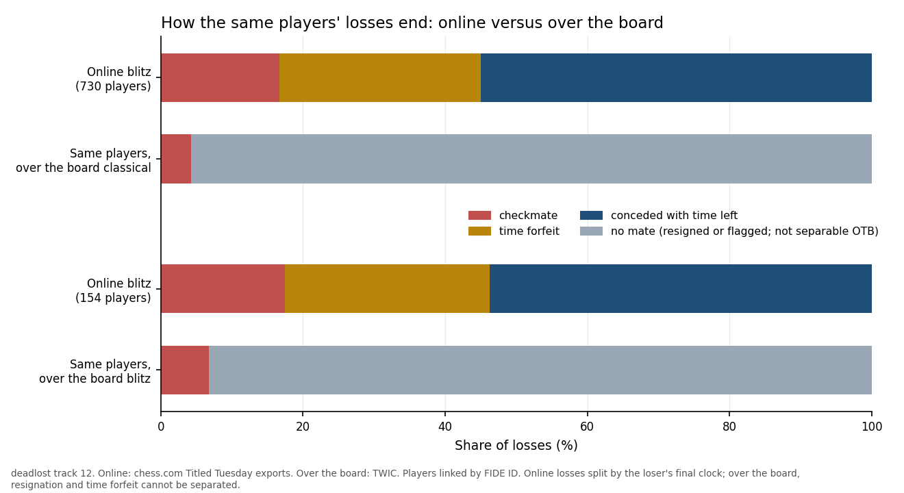

<p align="center">
  
</p>

<p align="center">
  <a href="https://github.com/ASM-21/deadlost/actions/workflows/ci.yml"></a>
  
  
  
  
  
</p>

<h1 align="center">deadlost</h1>

<p align="center"><b>Chess folk wisdom, tested on hundreds of thousands of real games with Stockfish as the referee.<br>
Then attacked, as hard as it was built, by a track whose only job is to break the others.</b></p>

<p align="center"><i>dead lost</i> (chess): a position so hopeless that only the opponent can save it.<br>
It is where this project's sharpest result lives: whether players concede those positions or play them out.</p>

<p align="center">
  <a href="FINDINGS.md">Findings</a> ·
  <a href="docs/LITERATURE.md">Literature review</a> ·
  <a href="#quick-start">Quick start</a> ·
  <a href="#what-this-repository-got-wrong">What it got wrong</a> ·
  <a href="docs/FAQ.md">FAQ</a> ·
  <a href="#citing">Cite</a>
</p>

---

## The headline

**Lost positions get saved far more often online than over the board, and it is
not because online players defend better. It is because over-the-board players
give up.**

Take 730 titled players who appear in both chess.com's online Titled Tuesday and
in classical tournament play, and match them across the two sources by their
FIDE ID. Then look only at games they *lost*:

<p align="center">
  
</p>

- **16.6%** of their online losses end in checkmate, against **4.3%** of their
  classical ones: **+12.4 points**, same people, so skill is held fixed.
- The gap is not just speed. Against the same players' over-the-board *blitz*,
  it is still **+10.7 points**.
- Online, about **30%** of their losses are time forfeits. Playing on is partly a
  bet on the opponent's clock. That is why the checkmate contrast is the clean
  estimate here: concession contrasts are bounds.

No prior study comparing this across formats turned up in two literature
searches; its closest relative studies resignation online only (Purohit &
Srivastava 2026).

## Quick start

```bash
pip install -e ".[dev]"            # Python 3.10+
bash scripts/fetch_data.sh         # ~230 MB of public games from GitHub mirrors
make tracks && deadlost findings   # every result, from the committed engine output
```

That reproduces every number in this repository in minutes, because the
expensive part, about two hours of Stockfish analysis, ships with it in
`data/eval/`. To redo the engine work from scratch, install Stockfish and run
`bash scripts/build_all.sh`.

## What it found

| # | Claim | Status | Evidence |
|---|---|---|---|
| 1 | Blunder rate falls steeply with rating | Replicates | 8.3% of moves at 1200-1400 down to 2.5% at 2000-2200; holds in all 180 analytic specifications (joint p = 0.002) |
| 2 | Faster games produce more blunders | Borderline | 29% more at the reported specification, but joint p = 0.052 once analytic choices are accounted for |
| 3 | Thinking time is a small effect in a lot of noise | Consistent | The time budget explains almost none of the between-game variance |
| 4 | White's edge grows with playing strength | Replicates | White scores 0.533 at 2200-2400 and 0.558 at 2600+ |
| 5 | Classical draw rates are rising | Consistent | +3.1% per decade; +4.0% comparing 2021-25 with 2015-19 |
| 6 | Engine opening evaluations don't predict practical results | Consistent | No rating band survives multiplicity correction |
| 7 | No detectable rating drift at a fixed rating | Null | −0.71 cp per decade, but it could only have seen drift of about ±1.5 |
| 8 | Ageing and calendar time can't be separated within a career | Replicates | The textbook age-period-cohort limit, met in practice |
| 9 | Lost positions are saved online because players there don't concede | **New** | The headline above; the same pattern appears in Lichess rapid, TWIC's online events and chess.com's own exports |

**New**: no prior study found. **Replicates**: a known result, reproduced.
**Consistent**: agrees with prior work, not an independent test of it.
**Borderline**: stable in direction, fragile in significance. **Null**: no
effect, reported with the smallest effect it could have detected.

Only one of the nine is new, and the table says so. The full argument, with
evidence, scope and prior work for each claim, is in **[FINDINGS.md](FINDINGS.md)**.

## What this repository got wrong

Seven claims were published here and later withdrawn. Each one is pinned by a test
that fails if the withdrawn claim ever comes back.

| # | Withdrawn claim | What it really was |
|---|---|---|
| 1 | Save rate falls steadily with rating | Stopping engine analysis at move 60 threw away long defensive games |
| 2 | Amateurs save by winning, masters by drawing | Masters draw more of every game; the contrast was a base rate |
| 3 | Draw rates are falling in master chess | The tournament corpus became mostly online blitz in 2020 |
| 4 | Players now play on longer once lost | The same online blitz |
| 5 | A bigger player panel flipped an estimate's sign | The same online blitz, again |
| 6 | An "inflation of 30-100 Elo per decade" benchmark | Never sourced; the documented concern is deflation |
| 7 | An external check citing a Lichess checkmate share from a 2026 paper | The figure could not be found in that paper |

**Retractions 3 to 5 share one cause, and no test caught it.** From 2020, The
Week In Chess is 55% online events, against 95.5% classical before, and it carries
no time-control tag. Every check in this repository ran on the contaminated data
and passed. What exposed it was a 2026 paper reporting classical draw rates
*rising* after 2020 while this repository reported them falling. Reading the
literature after the results existed did what no automated check could.

## Why you can trust it, and how far

- **Every number is pinned.** 57 published numbers are bound to results files by
  `scripts/check_claims.py`, which fails the build if one drifts, reverses sign,
  appears in this README without a registered source, or loses a required caveat.
- **The headline was replicated on different games.** Track 11 and track 12 both
  use online events, but only 2.4% of track 12's games appear in track 11's
  sample, so their agreement is two looks at different data.
- **The headline was replicated by independent code.** Track 12 was re-implemented
  from the raw files with separate parsing, joining and resampling, and the
  headline came out the same: 730 players, +12.4 points.
- **Unanimous agreement is not taken as evidence.** All 180 specifications of
  claim 2 agree in sign, yet joint inference across them finds it borderline: they
  all use the same games.
- **Every null says what it could have missed.** `deadlost limits` prints the
  resolution of each one.
- **Moves are not independent observations.** Intervals resample whole games or
  players; doing otherwise would make them 1.48x too narrow.
- **Eight probes try to break the other tracks.** One fires today, and it is the
  reason for retraction 2.
- **It reproduces from nothing.** A fresh clone on a different numerical library
  build regenerates every result with no drift beyond the tenth significant digit.

## Use it

```bash
deadlost findings       # one line per claim
deadlost limits         # resolution bounds, confounds, retractions
deadlost verify         # tests, claims check and provenance manifest, in one go
deadlost export         # 148k engine-scored moves, with a data dictionary
```

`deadlost export` is the part most worth reusing: engine evaluations are the only
expensive artifact here. Its data dictionary documents five traps in this data,
four of which caused real errors while building this repository.

## Open blocker

Lichess's official database and TWIC's own site were unreachable from the build
environment, so the corpora come from GitHub mirrors. That leaves three questions
open: whether errors jump at some bullet or blitz threshold, how errors depend on
the time left on the clock, and how often over-the-board losses are resignations
rather than time forfeits. Pointing `scripts/fetch_data.sh` at a Lichess monthly
dump would answer the first two.

## Contributing

The most wanted contribution is **a challenge to a finding**, and there is an
issue template for it: two literature passes and seven retractions came from
exactly that kind of scrutiny. Good first projects for a newcomer:

1. **Re-run track 2 position by position.** Park (2026) works at that level;
   track 2 aggregates whole opening families.
2. **Add a clock track.** Titled Tuesday exports already carry per-move clocks;
   test whether blunders rise as the clock runs down.

See [CONTRIBUTING.md](CONTRIBUTING.md).

## Citing

If you cite a null, cite its resolution with it. If you cite claim 9, cite the
checkmate contrast, which is the clean estimate. Online TWIC events are mostly
blitz, so their comparison with over-the-board fast play still carries some speed
difference; the blitz-against-blitz comparison above is the cleaner test. The
players compared are a selected, mostly titled group.

```bibtex
@software{morrissey_deadlost_2026,
  author  = {Morrissey, Andrew},
  title   = {deadlost: falsifiable analyses of public chess games against engine ground truth},
  year    = {2026},
  version = {1.3.0},
  url     = {https://github.com/ASM-21/deadlost},
  license = {Apache-2.0}
}
```

Machine-readable metadata is in [CITATION.cff](CITATION.cff).

## Data and licence

| Source | Used for | Terms |
|---|---|---|
| Lichess 2017 game scrape (datasnaek), via ogreowl/chess-analysis | online games, rapid | CC0 |
| The Week In Chess issues 210-1649, via rozim/ChessData | over-the-board games, 1998-2026 | game scores are facts; see NOTICE |
| chess.com Titled Tuesday exports, via ianrastall/titled-tuesday-archive | independent online corpus (track 12) | archive MIT; fetched, not redistributed |
| lichess-org/chess-openings | opening names | CC0 |
| Stockfish 16 | move evaluations | GPL-3.0, run as a separate program |

Code is Apache-2.0, copyright 2026 Andrew Morrissey. Third-party data keeps its
own terms, listed in [NOTICE](NOTICE). Stockfish is neither bundled nor linked.

<details>
<summary><b>Repository map</b></summary>

```
src/deadlost/
  schema.py            shared game record, format inference, validation
  ingest_*.py          one ingester per source
  engine.py            Stockfish wrapper: fixed node budget, per-game hash reset
  eval_run.py          stratified sampling, resumable sharded evaluation
  stats.py             cluster bootstrap, Wilson intervals, weighted regression
  power.py             minimum detectable effects for every null
  multiverse.py        specification curves with joint inference
  cli.py, export.py    the deadlost command and the reusable dataset
  tracks/t1..t12       one module per question
scripts/               fetch, build, claims check, power report, manifest, report page
tests/                 142 tests: behaviour, headline pins, retraction guards
results/               committed results, the single source of truth for all prose
data/eval/             committed engine evaluations
docs/                  literature review, bibliography, FAQ, findings page
```

</details>

<details>
<summary><b>Engine settings and other details</b></summary>

Stockfish 16 NNUE, one thread, a fixed node budget rather than fixed time so
results do not depend on machine load, a fresh transposition table for every game
so results do not depend on the order games were analysed in, every game analysed
to its end, and evaluations clamped to ±1500 centipawns. The first eight plies of
each game count as book. All three of those rules exist because their absence
caused a real error at some point; see [CHANGELOG.md](CHANGELOG.md).

</details>

<sub>Topics: chess, stockfish, lichess, reproducible-research, falsification,
specification-curve, open-data, statistics, python</sub>
