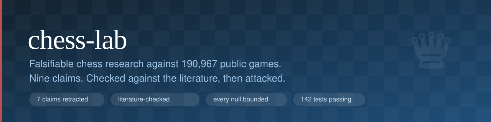

<p align="center">
  
</p>

<p align="center">
  <a href="https://github.com/OWNER/chess-lab/actions/workflows/ci.yml"></a>
  
  
  
  
  
</p>

# chess-lab

**Eleven questions people repeat about chess, checked against 190,967 real games
and Stockfish 16. One track exists only to break the others.**

Most research repositories are built to defend their results. This one is built
to attack them, and it reports where the attacks succeeded: two published claims
have been retracted, every null carries a resolution bound saying what it could
not have detected, and two of seven falsification probes currently fire.

**The sharpest result.** Lost positions are saved more than twice as often
online as over the board. It is not that online players defend better. Matching
both populations on engine-measured skill *widens* the gap rather than shrinking
it, and the real cause is behavioural: of players who went on to lose, 32.0%
online played the position to checkmate against 5.8% over the board. You cannot
save a game you have already resigned. Getting there required noticing that the
termination metadata thought to be necessary was recoverable from the move list
itself, and validating that recovery against the one corpus that had both.

```bash
pip install -e ".[dev]" && apt-get install stockfish
./scripts/fetch_data.sh      # ~150 MB from GitHub mirrors
./scripts/build_all.sh       # ~1h, engine-bound, fully resumable
```

Then `chesslab findings`, `chesslab limits`, or open
[FINDINGS.md](FINDINGS.md). To reproduce the analysis without re-running the
engine, keep `data/eval/` and run `make tracks` (seconds, not hours).

**[Findings](FINDINGS.md)** · **[FAQ](docs/FAQ.md)** · **[Open blockers](#open-blockers)** · **[Data dictionary](export/DATA_DICTIONARY.md)** · **[Changelog](CHANGELOG.md)** · **[Contributing](CONTRIBUTING.md)** · **[Roadmap](ROADMAP.md)**

## Headline results

| # | Question | Answer |
|---|---|---|
| 3 | Do blunders scale with thinking time? | Rate falls from 8.3% of moves at 1200-1400 to 2.5% at 2000-2200. Fast games blunder 29% more than slow. The *threshold* question is untestable here: the corpus has no bullet. |
| 5 | Is White's advantage shrinking? | No. White scores 0.530 at 2200-2400 rising to 0.553 at 2600+, so the edge *grows* with strength. Draws are falling 5.9% per decade, not rising. |
| 2 | Do engine-approved openings win more? | No. Nothing survives multiplicity correction, rho flips sign across bands, and mainline openings span only 25.8cp. |
| 4 | Has the rating pool inflated? | Null. +0.69cp per decade at fixed 2400-2499 rating, CI spanning zero. Cannot separate inflation from population change, and says so. |
| 6 | How often is a lost position saved? | Online bands flat within noise; the surviving gap is confounded with format. **Two claims retracted.** |
| 9 | Same question, format held constant | No gradient across 400 Elo of over-the-board play. Save rate is 18.9% online vs 7.6% OTB, with neither corpus showing an internal rating trend: that pattern points at format, not strength. |
| 8 | Same question as 4, following the same players | Null again (+1.32cp/decade, 100-player panel). Removes the composition confound; hits a structural one instead. Tripling the panel flipped the earlier point estimate's sign, which is documented rather than quietly corrected. |
| 7 | Do the above survive attack? | 2 of 7 probes fire. One forced a retraction; one forced tracks 4 and 8 to change their headline specification. |
| 11 | Is the online/over-the-board save gap skill or format? | Resignation, measured directly. Over-the-board players play a lost position to checkmate 5.8% of the time against 32.0% online. Matching on engine-measured skill *widens* the gap rather than shrinking it. |
| 10 | Do the findings survive the analytic choices behind them? | Track 3's results hold in 180 of 180 specifications. The blunder threshold alone drives 94% of the spread. |

## Why you can trust the numbers

Or rather: here is exactly how far to trust them.

**Nothing is claimed beyond the corpus.** The Lichess file is one 2017 scrape;
TWIC is tournament chess as reported by one publication. The scope table in
FINDINGS.md states rating ranges, time controls and year spans, and every
finding is phrased against them.

**Moves are not independent observations.** One game contributes ~60 correlated
moves. Every interval computed on move-level data resamples whole *games*.
Probe P4 quantifies what skipping this would have cost: intervals 1.47x too
narrow.

**Engine settings are fixed by node count, not time,** so a loaded machine
produces the same numbers as an idle one. Probe P2 re-runs a paired 60-game
subsample at 4x the search budget: the by-band ordering survives.

**Group differences are tested as differences.** The fast-vs-slow blunder gap
has overlapping separate intervals but a difference interval that excludes
zero. Checking overlap is the wrong test and this repo does not use it.

**A track exists to break the other tracks.** Track 7 runs six probes designed
to falsify tracks 2-6 and 8. One still fires, and its retraction is pinned;
`scripts/check_claims.py` fails if the retraction text is removed while the
probe still fires. A second probe fired against censoring and now passes because
the cause was removed rather than bounded.

**Evaluation is reproducible, and was not always.** An earlier build shared one
Stockfish transposition table across every game in a process, so results
depended on how a resumable run happened to be chunked, worth about 19cp per
move. Every search now passes a per-game key. Probe P6 guards it: evaluation
must be order-independent and bitwise-identical to a fresh process.

**Findings are audited across every defensible analytic choice.** Track 10 runs
specification curves over the thresholds, cutoffs and windows behind the main
claims. Track 3's gradient is negative in all 180 combinations, and the reported
specification sits at the 74th percentile rather than at a flattering extreme.

**Every null carries a resolution bound.** `scripts/power_report.py` computes
the minimum detectable effect for each one, accounting for clustering (a 2.18x
sample penalty). This is not flattering: neither inflation null is powered
against the drift rate people actually claim, and FINDINGS.md says so in a table
rather than burying it.

**Drift is detectable.** `scripts/manifest.py` content-hashes every module,
result, prose file and engine parquet, with environment and git provenance.
`manifest.py check` fails on any change. This exists because files in this
repository were once modified mid-build by something outside the session that
produced them, and it was caught by luck rather than by process.

**Every published number is pinned.** `tests/test_headlines.py` asserts each
headline against the committed results JSON, and `scripts/check_claims.py`
binds each number in this README to a source path. A README percentage with no
registered source is a build failure.

**What went wrong is written down.** Four errors caught during the build are
kept in the repo with tests pinning them: an endogenous time axis in track 3
that reversed an effect's sign, a shared engine hash table that broke
reproducibility, a censoring rule that manufactured a monotone trend in track 6,
and a collinear regressor in track 8 that the solver silently split across two
coefficient names. The failures are more reusable than the findings.

## Using it without reading the source

```bash
chesslab findings          # what the repo concludes, one line per track
chesslab findings --track 3
chesslab limits            # resolution bounds, retractions, confounds
chesslab status            # what is built, what has drifted
chesslab verify            # tests + claims check + manifest check
chesslab export            # documented dataset for your own analysis
```

`chesslab export` writes `moves.parquet` (125,673 engine-scored moves joined to
game metadata), `games.parquet`, and a data dictionary. The evaluations are the
only expensive part of this repo, roughly an hour of single-core Stockfish, so
that export is the artifact worth reusing. The dictionary documents four traps,
three of which produced real errors during this build.

## Publishing a fork

See [PUBLISHING.md](PUBLISHING.md). The short version:

## First-time setup after cloning or forking

```bash
python scripts/init_repo.py <your-github-username>   # fixes badge and template links
make install
```

Then enable GitHub Pages from `/docs` to publish the findings page, and set
`assets/banner.svg` as the social preview image.

## Quick start

```bash
pip install -e ".[dev]"
apt-get install stockfish          # or: brew install stockfish
./scripts/fetch_data.sh            # ~150 MB from GitHub mirrors
./scripts/build_all.sh             # ~45-60 min, engine-bound, resumable
```

Every engine stage checkpoints to `data/eval/`, so an interrupted run resumes
where it stopped. To reproduce the analysis without re-running the engine, keep
`data/eval/` and run any track module directly:

```bash
python -m chesslab.tracks.t3_blunders
python -m chesslab.tracks.t9_otb_swindles
python -m chesslab.tracks.t7_falsify
python scripts/power_report.py
python scripts/manifest.py check
python -m pytest -q
```

## Layout

```
src/chesslab/
  schema.py        shared game record, SAN handling, validation
  ingest_lichess.py, ingest_twic.py
  engine.py        Stockfish wrapper, centipawn conventions
  eval_run.py      stratified sampling, resumable sharded evaluation
  stats.py         cluster bootstrap, Wilson, weighted OLS
  openings.py      ECO classification from played moves
  power.py         minimum detectable effects for the nulls
  multiverse.py    specification curves over analytic choices
  cli.py           the `chesslab` command
  export.py        reusable dataset + data dictionary
  tracks/t1..t11   one module per question
scripts/           fetch, build, claims check, power report, manifest,
                   node calibration, findings page, repo init
docs/              FAQ and the generated findings page (GitHub Pages)
tests/             117 tests: core behaviour + headline pins
results/           committed JSON, the source of truth for all prose
figures/
```

## Data sources and licensing

| Source | Used for | Licence |
|---|---|---|
| [ogreowl/chess-analysis](https://github.com/ogreowl/chess-analysis) mirror of the datasnaek Lichess scrape | online corpus | CC0 (upstream Kaggle) |
| [rozim/ChessData](https://github.com/rozim/ChessData) TWIC issues 210-1649 | OTB corpus | game scores are facts, not copyrightable; see NOTICE |
| [lichess-org/chess-openings](https://github.com/lichess-org/chess-openings) | ECO classification | CC0 |
| Stockfish 16 | evaluations | GPL-3.0, invoked as a separate process via UCI |

Stockfish is called as an external binary over UCI and is not linked or
redistributed, so this repository's MIT licence applies to its own code only.
See [NOTICE](NOTICE).

## Limitations worth reading before citing

- Two corpora, both convenience samples. Not a random sample of chess.
- The engine sample is 1,748 games, not 190,967. Corpus-wide claims (results,
  openings, colour) use everything; centipawn claims use the sample.
- Opening choice is self-selected, so track 2 cannot separate opening quality
  from who plays it.
- Track 4's design cannot distinguish rating inflation from a change in who
  holds a given rating.
- Track 6 is the weakest track here: its monotonicity claim did not survive
  removing censoring, and the one contrast that remains is confounded with
  playing format. Track 9 addresses that confound and finds nothing, but at a
  resolution too coarse to be reassuring.
- Every null in this repo is underpowered against the effect size that would
  matter. See the resolution table in FINDINGS.md before citing any of them.
- Track 8 removes track 4's composition confound but cannot separate calendar
  drift from career trajectory: within a player those are the same regressor.

## Open blockers

One external blocker, stated once and scoped.

**`database.lichess.org`, `lichess.org` and `theweekinchess.com` are not
reachable from the environment this was built in.** Both corpora therefore come
from GitHub mirrors, re-tested and still blocked as of the last build. Three
consequences, all load-bearing:

1. **Track 3's threshold question is untestable.** The online corpus is one 2017
   scrape and is almost entirely rapid: bullet and blitz together are under 2% of
   it. There is no bullet or blitz to find a kink against. Searched
   for GitHub mirrors carrying bullet/blitz PGN or `[%clk]` clock annotations;
   none exist in usable form.
2. **Within-game time pressure cannot be studied at all.** That needs per-move
   clock times, which only the official PGN exports carry.
3. **Track 11 cannot fully separate resignation from losing on time**, because
   TWIC carries no termination tags. Classical over-the-board games rarely end on
   the clock, so the reported figure is close to a pure resignation rate, but it
   is a bound rather than an exact measurement.

Anyone with unrestricted network access can lift all three by pointing
`scripts/fetch_data.sh` at a real Lichess monthly dump. Nothing else in the
repository depends on the mirrors.

**Not a blocker, but worth knowing:** every null here is underpowered against
the effect size that would matter. That is a sample-size fact, quantified in
`chesslab limits`, not an unresolved bug.

## Challenge a finding

This is the contribution the repo most wants, and there is an
[issue template](.github/ISSUE_TEMPLATE/challenge-a-finding.yml) for it. Two
published claims have already been withdrawn after exactly this kind of
scrutiny.

Before filing, `chesslab limits` prints every known confound and the resolution
bound on every null, so you can check whether the objection is already
documented. The most useful challenges name a check that can be written as a
probe in `tracks/t7_falsify.py` with a pass condition stated in advance. A probe
that fires is a result: the affected claim gets downgraded, not the probe.

## Citing

See [CITATION.cff](CITATION.cff). If you cite a null, cite its resolution bound
with it; several of them do not rule out the effect sizes people care about, and
FINDINGS.md gives the number for each.

## Licence

MIT for this repository's own code. Game scores are facts and not
copyrightable; upstream data sources and their terms are listed in
[NOTICE](NOTICE). Stockfish (GPL-3.0) is invoked as a separate process and is
neither bundled nor linked.

See [LICENSE](LICENSE) and [NOTICE](NOTICE).


---

<sub>Suggested repository topics: `chess` `stockfish` `reproducible-research`
`data-analysis` `falsification` `python` `lichess` `statistics` `open-data`</sub>
